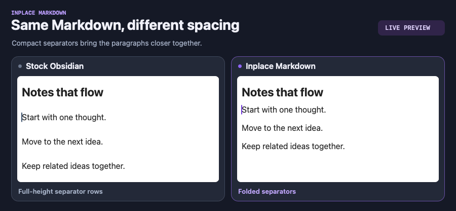

# Inplace Markdown

## TL;DR

**Make Obsidian Live Preview feel like a writing editor.** Press **Enter** for a new paragraph, **Shift+Enter** for a line break, and **↓** to move past a folded separator. Intentional blank rows stay editable, and your notes stay plain Markdown.

[Features](#features) · [Install](#install) · [Keyboard and mouse](#keyboard-and-mouse) · [Compatibility](#compatibility)



*Recorded in Obsidian desktop using the same Markdown in both panes.*

## Features

- **Paragraphs at a glance.** Folded spacer rows make paragraphs easier to scan. Headings get their own spacing, and gaps around lists and at the start or end of a note follow the same layout rules.
- **Navigation that matches what you see.** Arrow keys skip folded separators and can still stop on intentional full-height blank rows. Drag through a folded gap to select its source newline.
- **Familiar writing shortcuts.** Enter starts a paragraph in body text and at the end of an ATX heading. Shift+Enter inserts a single newline. Enter on an empty top-level list item exits the list into a new paragraph.
- **Remove an empty row in one keystroke.** Backspace on a full-height blank row removes the two source newlines around it. Undo restores them together.
- **Built into Live Preview.** Use Obsidian's existing editor, theme, and Markdown files. Switch to Source mode whenever you want to inspect every newline.

## Install

**Requirements.** Obsidian desktop **1.5.0 or newer**, as declared in the plugin manifest. These steps use the built files in this repository.

1. Download [`main.js`](main.js), [`manifest.json`](manifest.json), and [`styles.css`](styles.css). Use **Download raw file** for each file on GitHub.
2. Put all three files in this folder inside your vault:

   ```text
   <vault>/.obsidian/plugins/obsidian-inplace/
   ```

3. Restart Obsidian, open **Settings → Community plugins**, and enable **Inplace Markdown**.
4. Open a note in **Live Preview**. The spacing and shortcuts apply automatically.

To update, replace the same three files and restart Obsidian.

## Keyboard and mouse

| Action in Live Preview | Result |
| --- | --- |
| **Enter** in body text or at the end of an ATX heading | Start a paragraph. A Markdown paragraph boundary uses two newlines. |
| **Shift+Enter** in body text or at the end of an ATX heading | Insert one newline. |
| **↑ / ↓** across a gap | Skip folded separators and stop on full-height blank rows. |
| **Click** a folded separator | Place the caret on a neighboring editable row. |
| **Drag** across a folded separator | Include the original newline in the selection. |
| **Backspace** on a full-height blank row | Delete the two newlines around that row. |

A new empty paragraph remains editable while the caret is there. At the end of a note, pressing Backspace immediately after Enter removes the new paragraph break in one step.

### How blank lines are displayed

| Blank lines in Markdown | Appearance between blocks |
| --- | --- |
| **1** | One compact separator. |
| **2** | Two compact separators. |
| **3 or more** | One compact separator at each edge, with one editable, full-height row for each interior blank line. |

## Compatibility

The plugin works on its own. The integration suite also covers the **Cupertino** theme with **Unified Typography**, **Paragraph Enter**, and **Notion Block** enabled together.

- **Unified Typography.** When its editing styles are active, Inplace uses its paragraph spacing and body line height. Heading separators use a separate height.
- **Paragraph Enter.** Inplace handles the shortcuts listed above in Live Preview. Other editor contexts use their existing key bindings.
- **Structured Markdown.** Nested lists, tables, and fenced code retain their own editing behavior. Source mode and Reading view remain available through Obsidian.

## Build and test

```sh
npm ci
npm run build
npm test
npm run test:obsidian
```

The desktop integration suite launches Obsidian against a temporary vault. It covers one to ten blank lines before headings and body text, cursor movement, mouse selection, deletion, and list and end-of-file behavior.

<details>
<summary>Integration test options</summary>

- `OBSIDIAN_PATH` points to the desktop executable.
- `OBSIDIAN_RUNTIME_ASAR` points to an Obsidian runtime package for the temporary profile.
- `OBSIDIAN_COMPANIONS` points to a folder containing Unified Typography and Paragraph Enter. Set `OBSIDIAN_NOTION_BLOCK=1` to include Notion Block.
- `OBSIDIAN_THEME_CSS` points to a theme stylesheet.

</details>

## Feedback

When reporting a spacing or caret issue, include your Obsidian version, theme, related plugins, and the smallest Markdown snippet that reproduces it. Please keep the original blank lines in the snippet.
